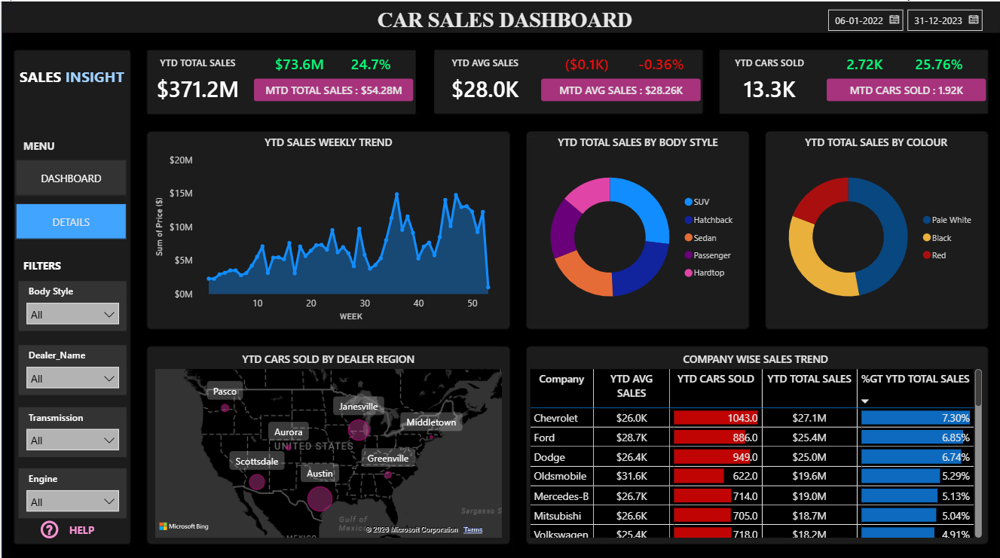
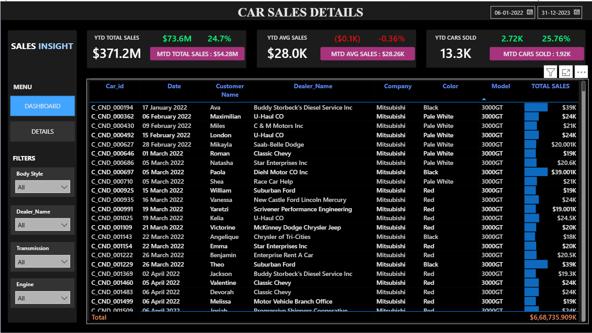

# 🚗 Car Sales Dashboard | Power BI

An interactive Power BI dashboard built to analyze car sales performance across different regions, dealers, companies, body styles, and time periods. The dashboard helps identify key sales trends, monitor KPIs, and enables business users to make data-driven decisions through interactive visualizations.

---

## 📌 Project Overview

This project provides an end-to-end sales analysis dashboard for a car dealership business. It allows users to monitor Year-to-Date (YTD) and Month-to-Date (MTD) performance, compare sales across different dimensions, and explore detailed transaction-level records.

The dashboard includes dynamic filters and interactive visuals to quickly identify business insights.

---

## 📊 Dashboard Preview

### Sales Dashboard



### Sales Details



---

## 🎯 Business Objectives

- Monitor overall sales performance.
- Track YTD and MTD sales.
- Analyze sales trends over time.
- Compare dealer performance.
- Identify top-performing car companies.
- Analyze sales by body style and color.
- Explore detailed sales transactions.
- Enable interactive filtering for business users.

---

## 📈 Key Performance Indicators (KPIs)

- 💰 YTD Total Sales
- 📅 MTD Total Sales
- 🚘 YTD Cars Sold
- 📅 MTD Cars Sold
- 💵 YTD Average Sales
- 📅 MTD Average Sales
- 📊 Sales Growth (%)

---

## 📊 Dashboard Features

### Sales Overview

- YTD Weekly Sales Trend
- Sales by Body Style
- Sales by Car Color
- Dealer Region Map
- Company-wise Sales Performance

### Sales Details

- Complete transaction-level sales table
- Customer information
- Dealer information
- Company
- Model
- Color
- Sales Amount

---

## 🎛 Interactive Filters

Users can analyze data using:

- Body Style
- Dealer Name
- Transmission
- Engine Type
- Date Range

---

## 📌 Insights Generated

- Identify best-performing dealers.
- Compare sales among different car manufacturers.
- Understand customer purchasing trends.
- Analyze regional sales performance.
- Track weekly sales growth.
- Monitor business KPIs in real time.

---

## 🛠 Tools Used

- Microsoft Excel
  - Data preparation
  - Data cleaning

- Microsoft Power BI
  - Data Modeling
  - DAX Measures
  - Interactive Dashboard
  - KPI Cards
  - Maps
  - Charts
  - Slicers

---

## 📂 Project Structure

```
Car-Sales-Dashboard/
│
├── Images/
│   ├── Dashboard.png
│   └── Details.png
│
├── Dataset/
│   └── Car Sales Dataset.xlsx
│
├── PowerBI/
│   └── Car Sales Dashboard.pbix
│
└── README.md
```

---

## 📁 Dataset

The dataset used for this project contains car sales transaction data including:

- Customer Details
- Dealer Information
- Vehicle Company
- Vehicle Model
- Body Style
- Engine Type
- Transmission
- Color
- Sales Date
- Sales Amount

> **Note:** The original dataset is currently not included in this repository. It will be added later if available.

---

## 🚀 Skills Demonstrated

- Data Cleaning
- Data Transformation
- Data Modeling
- DAX Calculations
- Dashboard Design
- Business Intelligence
- Data Visualization
- KPI Reporting

---

## 📚 Future Improvements

- Profit Analysis
- Forecasting
- Customer Segmentation
- Dealer Performance Scorecard
- Mobile Dashboard Optimization

---

# 🤝 Connect With Me

## Rahul Kumar Sao

🎓 Final Year B.Tech Student | Aspiring Data Analyst

📌 **GitHub**

[GitHub](https://github.com/rahulkumar200410)

📌 **LinkedIn**

[LinkedIn](https://www.linkedin.com/in/rahul-kumar-sao-8a5175322)

---

## ⭐ If you found this project useful, consider giving it a Star!

Feedback and suggestions are always welcome.

---

**Thank you for visiting this repository!**